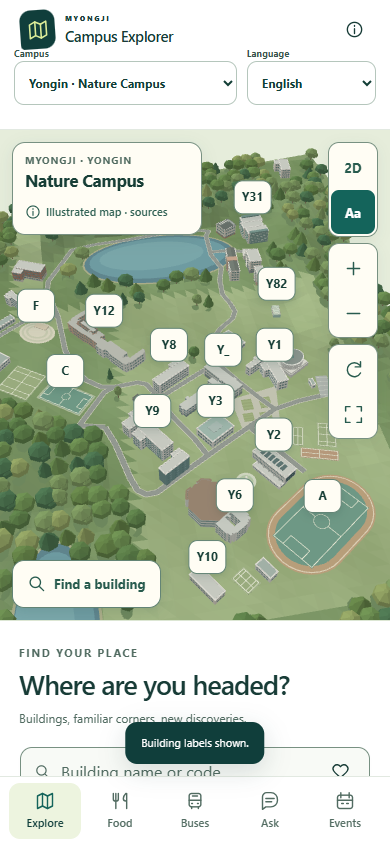
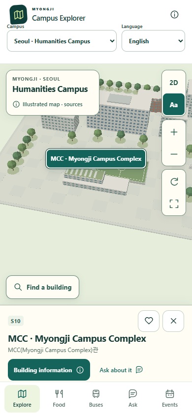

# Myongji Campus Explorer

An independent student guide to **Myongji University's Yongin and Seoul campuses**, with interactive 3D reference maps and an offline, source-based campus assistant.

**English · 한국어 · 简体中文**

[Download v0.5.0](https://github.com/davidijesus/myongji-campus-explorer/releases/tag/v0.5.0) · [Installation](docs/INSTALL.md) · [Test report](docs/TEST_REPORT.md) · [Distribution guide](docs/DISTRIBUTION_GUIDE.md)

| Yongin · Nature Campus | Seoul · Humanities Campus |
| --- | --- |
|  |  |

## What it does

- **Explore both campuses:** switch campuses, search names or building codes, select buildings, save favorites, and pan, rotate or zoom the 2D/3D map. A software renderer works when WebGL is unavailable.
- **Find food and coffee:** 14 university-listed facilities in Yongin and four in Seoul, with source links and explicit unknown hours and prices.
- **Check transport guidance:** five regular Yongin semester timetable options, with Seoul-time and validity checks. Seoul shows public transport guidance and the cited end of the intercampus trial shuttle from October 1, 2026; no departure times are invented.
- **Ask campus questions:** local, deterministic answers with citations and map actions. Verified classroom prefixes can identify buildings; the app cannot read personal timetables or infer class assignments.
- **Choose a language:** English, Korean or Simplified Chinese. Campus, language and favorites persist locally; each campus has its own session-only chat history.

The bundled app needs no account, map credentials, chatbot API key or runtime CDN. External source pages require an internet connection. It has no ads or analytics.

## Try it

Download the [Android APK or installable web package](https://github.com/davidijesus/myongji-campus-explorer/releases/tag/v0.5.0), or clone the repository and open `preview.html` in a browser. To serve it locally:

```sh
git clone https://github.com/davidijesus/myongji-campus-explorer.git
cd myongji-campus-explorer
npm ci
npm run build:pwa
npm run preview
```

Requires **Node.js 22.13 or later**. The preview runs at `http://127.0.0.1:4173`. Use `npm run preview:pwa` for the PWA at `http://127.0.0.1:4174`. Publish only `pwa/` over HTTPS for browser installation. Opening a file directly does not install a PWA.

Try **Y9228** in Yongin, **S10303** in Seoul, or ask where to buy coffee. Building-code results do not verify a room's existence, floor, entrance or current class assignment.

## Release status

| Deliverable | Status for v0.5.0 |
| --- | --- |
| Android APK | Built with Java/System WebView; development-signed, signature and embedded content verified. Minimum API 24; target API 36; version code 2. No Android permissions or bundled `.so` libraries. |
| Installable web app | Packaged; Chromium installation eligibility and offline browser restart checked. No public hosting or Safari/device installation is claimed. |
| Shared Expo source | Included; dependency-aware TypeScript passed. Native Android build issues from the previous attempt remain documented. |
| iPhone IPA / store release | Not produced or submitted. Apple signing, native compilation and device validation remain required. |

**This is a demonstration release. Android installation and updates, iPhone behavior, accessibility, battery use and sustained frame rate have not been validated on physical devices.** The APK uses a development certificate; production publisher signing and store review are separate steps. See [native validation](docs/NATIVE_VALIDATION.md).

The validated build passed **100 domain/content tests, 71 browser regression checks, 43 campus/language checks, 16 PWA checks, 30 Java link-policy cases and six desktop checks of the APK's extracted page under its security policy**. Those desktop checks are not Android runtime tests. The [test report](docs/TEST_REPORT.md) records scope and evidence.

## Evidence and map accuracy

University sources take precedence over conflicting student guidance. The supplied Yongin student-guide snapshot is not a live Notion connection and is not used as evidence for Seoul. English and Chinese building names are descriptive translations; the original Korean names remain available.

- **Yongin:** 50 selectable references. Forty-six placements follow the university's historical 2021 plan and its 300-metre graphic scale; four use disclosed directory anchors. Six connected halls use traced polygon footprints. See [spatial review](docs/SPATIAL_REVIEW.md) and [visual evidence](docs/VISUAL_REFERENCE_AUDIT.md).
- **Seoul:** eight buildings plus the sports field, gate and gatehouse from the official directory. Marker positions use a consistent metric projection. Footprints, heights and landscaping remain schematic. See [Seoul evidence](docs/SEOUL_EVIDENCE.md).

Neither scene is a current measured reconstruction. Entrances, pedestrian routes, walking times and step-free access are not verified. No fictional upcoming events, live bus arrivals, current prices or opening-status claims are added to fill missing data. Reference photographs and videos are linked, not bundled as app textures.

## Development

```sh
npm run build         # Generate browser page, mobile page and datasets
npm test              # Domain, content, evidence and localization tests
npm run typecheck
npm run build:pwa
```

With a Chromium browser available and the corresponding preview servers running:

```sh
npm run test:browser
npm run test:campuses
npm run test:pwa
```

Set `CHROMIUM_EXECUTABLE` if Chromium is not in Playwright's default installation. Mobile source checks are separate:

```sh
cd mobile
npm ci
npm run typecheck
```

Use [Android build instructions](android-standalone/README.md) for the delivered Java wrapper. The optional Expo/Naver integration in `mobile/` requires its own configuration and native validation. No private signing key is included in this repository.

```text
src/                 Campus registry, map renderer, localized UI and sourced assistant
web/                 Responsive styles and original icons
mobile/              Shared Expo/React Native source and generated offline page
android-standalone/  Java/System WebView Android wrapper and build instructions
server/              Optional protected content service and administrator CLI
data/                Public reference records and isolated development fixtures
tests/               Automated domain and browser checks
docs/                Evidence, screenshots, validation and publishing guidance
pwa/                 Generated web distribution; ready for HTTPS hosting
```

Edit source files and rebuild generated outputs. The bundled food, transport and assistant registers require an app rebuild when changed; the optional content service does not remotely update those registers.

## Documentation and license

- [Installation](docs/INSTALL.md) and [distribution options](docs/DISTRIBUTION_GUIDE.md)
- [Store release preparation](docs/STORE_RELEASE.md)
- [Content evidence](docs/CONTENT_EVIDENCE.md), [Yongin map evidence](docs/MAP_EVIDENCE.md) and [Seoul evidence](docs/SEOUL_EVIDENCE.md)
- [Test report](docs/TEST_REPORT.md) and [native validation](docs/NATIVE_VALIDATION.md)
- [Privacy draft](docs/PRIVACY.md) and [project showcase](docs/SHOWCASE.md)

Documentation is in English. Historical reports are explicitly labelled and do not replace the current validation record.

First-party code and original geometric assets use the [MIT License](LICENSE). University material, Naver SDKs and other dependencies retain their own terms. This independent project is not endorsed by Myongji University, Naver, Apple or Google.
